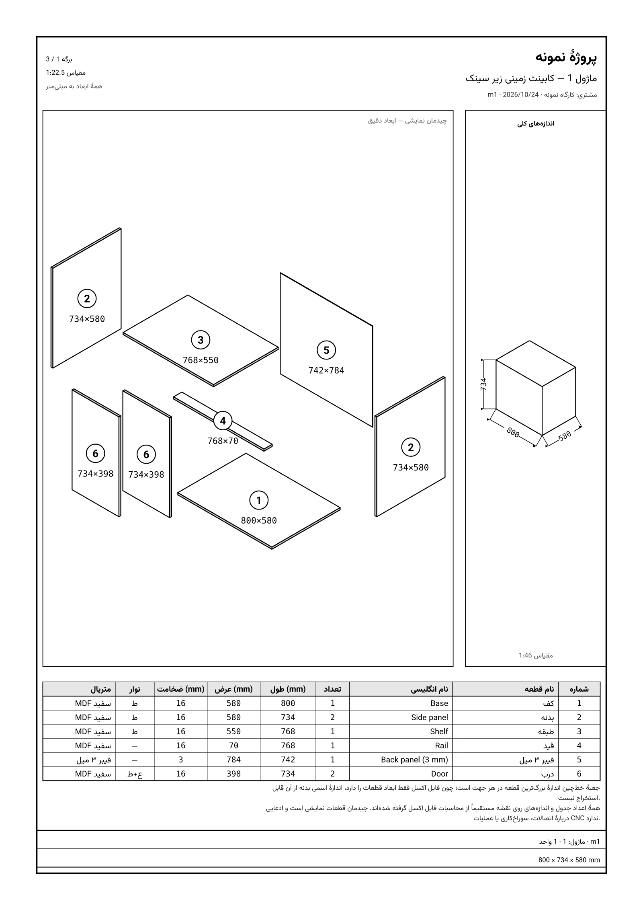

# راهنمای کارگاهی Cabinet Analysis Pro

**نسخهٔ برنامه:** ۰٫۱٫۰ · **ویرایش سند:** ۲ (Stage 6) · **تاریخ:** ۲۰۲۶/۱۰/۲۵
**کامیت مرجع شواهد (بیلد تأییدشده):** `2db4bee` · **شاخه:** `arena/44419380-max` ·
**PR:** [#1](https://github.com/gase99/Max/pull/1)

این دفترچه برای **اپراتور کارگاه** نوشته شده است: از نصب برنامه تا کنترل خروجی پیش از برش.
هر ادعای این سند یکی از سه برچسب زیر را دارد.

| برچسب | معنی دقیق |
|---|---|
| ✅ **تأییدشده** | شواهد اجرای واقعی در مخزن وجود دارد (تست خودکار یا اجرای برنامه) و قابل بازتولید است |
| 🟡 **آزموده‌شده در CI** | روی ماشین مجازی ویندوز در GitHub Actions اجرا شده؛ **روی رایانهٔ فیزیکی کارگاه آزمایش نشده است** |
| ⛔ **تأییدنشده** | هنوز هیچ شاهد اجرایی وجود ندارد؛ در این سند به‌عنوان «انجام‌شده» معرفی نمی‌شود |

جمع‌بندی شواهد فعلی: ۲۱۶ تست خودکار سبز · ۱۱۶/۱۱۶ بررسی زمان اجرا (فاز ۱) و ۱۲/۱۲
(فاز ۲) روی ویندوز CI · اجرای مرجع
[`40131272368`](https://github.com/gase99/Max/actions/runs/40131272368).

> ⚠️ **هشدار اصلی:** سبز بودن تست‌ها یعنی «کد مطابق انتظار کار می‌کند»، نه «ابعاد شما درست
> است». هر خروجی — لیست برش، نقشه، PDF، DXF — پیش از برش واقعی باید با سفارش و اندازه‌گیری
> کارگاه تطبیق داده و توسط مسئول فنی تأیید شود.

**تصمیم‌های فنی تأییدشده (۲۰۲۶-۱۰-۲۵):** فیبر ۳ میل = **پنل پشت کابینت** با ضخامت ۳ میلی‌متر ·
جهت رگه **وابسته به نوع قطعه** · `analiz pro.2.xlsx` **نسخهٔ رسمی مرجع**. این تصمیم‌ها فقط در
مستندات ثبت شده‌اند و **هیچ فرمول یا عددی در برنامه تغییر نکرده است** (جزئیات: بخش ۱۱.۱).

**راهنمای سریع یک‌صفحه‌ای:** [`docs/14-quick-reference.md`](14-quick-reference.md)

---

## فهرست

۱. معرفی برنامه · ۲. دریافت، نصب و اجرا · ۳. شروع یک پروژه ·
۴. وارد کردن اندازه‌ها و بررسی محاسبات · ۵. بررسی فهرست قطعات · ۶. نقشهٔ انفجاری و برگهٔ فنی ·
۷. چاپ و ذخیرهٔ PDF · ۸. خروجی DXF · ۹. کنترل کیفیت پیش از تولید · ۱۰. عیب‌یابی ·
۱۱. محدودیت‌ها و موارد نیازمند تأیید · ۱۲. فرم ثبت آزمون کارگاهی · ۱۳. پیوست

---

## ۱. معرفی برنامه

**Cabinet Analysis Pro** یک برنامهٔ **آفلاین ویندوز** برای تحلیل کابینت و MDF است که
محاسبات فایل اکسل کارگاه (`analiz pro.2.xlsx`) را بازتولید می‌کند و از همان اعداد،
فهرست برش، چیدمان ورق، نقشهٔ A4 و فایل DXF می‌سازد. ✅ **تأییدشده** (مقایسهٔ سلول‌به‌سلول،
`docs/10-excel-crossvalidation.md`).

### ۱.۱ برنامه چه کاری انجام می‌دهد

| کار | وضعیت |
|---|---|
| محاسبهٔ کابینت زمینی، هوایی و کشو با قواعد همان اکسل | ✅ تأییدشده (۱۵۸ تست موتور) |
| نمایش «ممیزی فرمول» با شمارهٔ سلول اکسل برای هر مقدار | ✅ تأییدشده |
| فهرست برش یکپارچه با فیلتر، جستجو و «ادغام قطعات یکسان» | ✅ تأییدشده |
| چیدمان ورق (guillotine)، درصد بهره‌وری و ضایعات | ✅ تأییدشده (تست عدم همپوشانی) |
| بهای تمام‌شده و قیمت پیشنهادی | ✅ تأییدشده |
| ذخیرهٔ پروژه روی همان دستگاه + پشتیبان JSON و بازیابی | ✅ تأییدشده در CI |
| نقشهٔ A4 با شمارهٔ قطعه، جدول دوزبانه و چندبرگی شدن | ✅ تأییدشده |
| خروجی DXF دوبعدی (R12، میلی‌متر، مقیاس ۱:۱) | ✅ تأییدشده (بازخوانی مجدد فایل) |
| خروجی CSV لیست برش و چیدمان ورق | ✅ تأییدشده (بررسی بایت‌های فایل در CI) |
| کارکرد بدون اینترنت | ✅ تأییدشده (صفر درخواست شبکه در تست زمان اجرا) |

### ۱.۲ برنامه چه کاری انجام **نمی‌دهد** (نسخهٔ ۰٫۱٫۰)

| انجام نمی‌شود | توضیح |
|---|---|
| سوراخ‌کاری، شیار، جیب، مسیر ابزار، G-code | فایل اکسل چنین داده‌ای ندارد؛ برنامه حدس نمی‌زند |
| تخصیص خودکار یراق (مثلاً «هر درب ۲ لولا») | مقدار یراق باید دستی وارد شود |
| خروجی `.xlsx` واقعی | فقط CSV سازگار با اکسل |
| طرح مونتاژ دقیق یا نقشهٔ ساخت | نقشهٔ A4 «انفجاری» است و چیدمان آن نمایشی |
| پشتیبانی چندکاربره / شبکه / ابری | عمداً پیاده نشده؛ همه‌چیز محلی است |
| امضای دیجیتال نصب‌کننده | گواهی موجود نیست |
| آزمون روی دستگاه فیزیکی کارگاه | انجام نشده؛ فقط ماشین مجازی CI |

### ۱.۳ اصطلاح‌ها

| اصطلاح | معنی در این برنامه |
|---|---|
| **واحد / ماژول** | یک کابینت زمینی، هوایی یا کشو که ابعادش وارد می‌شود |
| **قطعه** | تختهٔ برشی محاسبه‌شده (کف، بدنه، طبقه، قید، فیبر ۳ میل، درب…) |
| **ممیزی فرمول** | جدولی که هر عدد را با فرمول و شمارهٔ سلول اکسل نشان می‌دهد |
| **برگه** | یک صفحهٔ A4 از نقشهٔ انفجاری |

---

## ۲. دریافت، نصب و اجرا در ویندوز

### ۲.۱ محل دریافت فایل نصب

فایل اجرایی **در مخزن ذخیره نمی‌شود**؛ در هر بیلد روی ماشین ویندوز ساخته می‌شود.
مسیر دقیق:

1. `https://github.com/gase99/Max/actions` را باز کنید.
2. آخرین اجرای موفق **Windows release** را باز کنید (اجرای مرجع:
   [run 40131272368](https://github.com/gase99/Max/actions/runs/40131272368)).
3. پایین صفحه، بخش **Artifacts**:

| نام artifact | محتوا | مدت نگهداری |
|---|---|---|
| `cabinet-analysis-pro-windows-<sha>` | `Cabinet-Analysis-Pro-Setup-0.1.0.exe`، `Cabinet-Analysis-Pro-Portable-0.1.0.exe`، `latest.yml`، `SHA256SUMS.txt`، `release-info.json` | ۳۰ روز |
| `functional-test-report-<sha>` | گزارش‌های تست زمان اجرا (`smoke-report.json`، `smoke-report-phase2.json`)، لاگ‌ها، اسکرین‌شات، فایل‌های خروجی‌شدهٔ آزمایشی | ۷ روز |

> لینک مستقیم دانلود artifact ثابت نیست و به ازای هر اجرا عوض می‌شود؛ بنابراین در این سند
> لینک حدسی نوشته نشده است. از همان صفحهٔ اجرا دانلود کنید.

### ۲.۲ تفاوت نسخهٔ Setup و Portable

| مورد | `...Setup-0.1.0.exe` | `...Portable-0.1.0.exe` |
|---|---|---|
| نصب | دارد (NSIS، x64، انتخاب مسیر نصب) | ندارد؛ همان‌جا اجرا می‌شود |
| میان‌بر منوی استارت و دسکتاپ | بله | خیر |
| اجرای هم‌زمان دو نسخه | خیر (قفل تک‌نمونه) | خیر |
| داده‌ها | در پروفایل کاربر ویندوز | همان پروفایل کاربر ویندوز |

هر دو از یک بستهٔ `app.asar` ساخته می‌شوند و **دادهٔ مشترک** دارند: اگر هر دو را استفاده
می‌کنید، پروژه‌ها یکی هستند. 🟡 **آزموده‌شده در CI** (نصب بی‌صدا + اجرا + ماندن ۱۵ ثانیه).

### ۲.۳ نصب

1. فایل `Cabinet-Analysis-Pro-Setup-0.1.0.exe` را دوبار کلیک کنید.
2. مسیر نصب را انتخاب کنید (پیش‌فرض مناسب است) و نصب را کامل کنید.
3. در پایان، برنامه از منوی استارت با نام **Cabinet Analysis Pro** اجرا می‌شود.

> 📷 **تصویر موردنیاز:** «پنجرهٔ نصب NSIS در مرحلهٔ انتخاب مسیر نصب» — باید عنوان
> `Cabinet Analysis Pro 0.1.0`، مسیر نصب و دکمهٔ `Install` دیده شود. (روی دستگاه واقعی با
> `Win+Shift+S` گرفته شود و در `docs/img/` با نام `setup-wizard.png` ذخیره شود.)

### ۲.۴ هشدار Windows SmartScreen

اگر ویندوز پیام **Windows protected your PC** یا **Unknown publisher** نشان داد:

- **علت:** فایل **امضای دیجیتال ندارد** (نسخهٔ ۰٫۱٫۰ گواهی کد-امضا ندارد). ⛔ تأییدنشده از
  نظر زنجیرهٔ اعتماد ویندوز.
- **کار درست:** پیش از اجرا، **صحت فایل** را بررسی کنید (بخش ۲.۵). اگر عدد یکی بود،
  می‌توانید با `More info` → `Run anyway` ادامه دهید.
- **کار نادرست:** خاموش کردن کلی SmartScreen/Defender یا افزودن استثنای سراسری. این کار
  حفاظت دستگاه را برای همهٔ فایل‌های بعدی کم می‌کند و توصیه نمی‌شود.

### ۲.۵ بررسی صحت فایل نصب (SHA-256)

در PowerShell، در پوشهٔ فایل:

```powershell
Get-FileHash .\Cabinet-Analysis-Pro-Setup-0.1.0.exe -Algorithm SHA256
```

عدد را با `SHA256SUMS.txt` داخل همان artifact و با annotation اجرای همان بیلد مقایسه کنید.
SHA-256 هر دو فایل در هر اجرا محاسبه و در CI چاپ می‌شود. ✅ **تأییدشده** (مرحلهٔ
«Record version and installer SHA-256»).

مقادیر اجرای مرجع (`2db4bee`):

| فایل | SHA-256 |
|---|---|
| `Cabinet-Analysis-Pro-Setup-0.1.0.exe` | `d6bc4a891fac5130da33bf8fe514670bd6494e46ff6134d3a11ab3229a47e2d9` |
| `Cabinet-Analysis-Pro-Portable-0.1.0.exe` | `d2517276306015ab6f204db291bbf57559c729124de520093a74424bc75a723f` |

> این اعداد به همان بیلد تعلق دارند؛ با هر کامیت عوض می‌شوند. ملاک، عدد همان اجرایی است که
> فایل را از آن گرفته‌اید.

### ۲.۶ الزامات سیستم

| مورد | وضعیت |
|---|---|
| سیستم‌عامل | ویندوز ۶۴ بیتی (هدف بیلد: `x64`) — 🟡 فقط روی `windows-latest` گیت‌هاب اجرا شده |
| حداقل نسخهٔ ویندوز | ⛔ تأییدنشده — روی ویندوز ۷/۸/۱۰/۱۱ جداگانه آزمون نشده است |
| حافظه/پردازنده | ⛔ تأییدنشده — اندازه‌گیری نشده؛ برنامهٔ Electron با پنجرهٔ ۱۴۴۰×۹۰۰ و حداقل ۱۰۲۴×۶۸۰ |
| اینترنت | لازم نیست ✅ |
| نصب اضافی | لازم نیست (Electron و Chromium داخل بسته هستند) |

### ۲.۷ بستن و اجرای مجدد

- بستن: دکمهٔ ✕ پنجره، یا منوی **پرونده → خروج** (`Alt+F4` هم کار می‌کند).
- اجرای مجدد: برنامه همان پروژه‌ها را برمی‌گرداند. ✅ **تأییدشده**: فاز ۲ تست زمان اجرا در
  **فرایند جدید** همان پروفایل را باز می‌کند و پروژه، نام و ابعاد وارد‌شده سر جایشان هستند.
- اگر پنجرهٔ برنامه گم شد، اجرای دوبارهٔ میان‌بر پنجرهٔ موجود را جلو می‌آورد (قفل تک‌نمونه).

### ۲.۸ محل ذخیرهٔ داده‌ها

- پروژه‌ها و تنظیمات در حافظهٔ محلی پروفایل برنامه (`localStorage`) ذخیره می‌شوند، نه در یک
  فایل قابل‌دیدن. کلیدهـا: `cap.projects.v1`، `cap.settings.v1`، `cap.selected.v1`.
  ✅ تأییدشده (تست‌ها همین کلیدها را می‌خوانند).
- مسیر پیش‌فرض پروفایل در ویندوز: `%APPDATA%\<نام برنامه>` (رفتار استاندارد Electron).
  ⛔ **تأییدنشده** روی دستگاه فیزیکی؛ تا اندازه‌گیری نشده روی آن حساب نکنید.
- فایل‌های خروجی (CSV، DXF، HTML، JSON) در پوشهٔ **Downloads** همان کاربر ذخیره می‌شوند؛
  مسیر دقیق را خود ویندوز هنگام دانلود نشان می‌دهد. 🟡 آزموده‌شده در CI.
- **نتیجهٔ عملی:** تنها راه مطمئن انتقال داده، **پشتیبان JSON** است (بخش ۳.۵).

---

## ۳. شروع یک پروژه

### ۳.۱ ساخت پروژه

1. برنامه را باز کنید. صفحهٔ **داشبورد** می‌آید.
2. در منوی کنار (گروه «تحلیل») روی **«تحلیل جدید»** بزنید.
3. در کارت **«پروژهٔ جدید»**: **نام پروژه** و **مشتری** را بنویسید.
4. یکی از دکمه‌ها را بزنید:

> 📷 **تصویر موردنیاز:** «صفحهٔ تحلیل جدید» — کارت «پروژهٔ جدید» با فیلدهای نام پروژه/مشتری و
> دکمه‌های «جدید» و «جدید + کابینت زمینی»، به‌همراه کارت «شروع سریع» با دکمه‌های «＋».
> نام پیشنهادی فایل: `docs/img/new-analysis.png`.

| دکمه | نتیجه |
|---|---|
| **جدید** | پروژهٔ خالی می‌سازد و در همان صفحه می‌ماند |
| **جدید + کابینت زمینی** | پروژه را می‌سازد و مستقیم به صفحهٔ کابینت زمینی می‌رود |

> نکتهٔ مهم: اگر پروژه‌ای از قبل باز باشد، دکمه‌های «＋» واحد را به **همان پروژهٔ باز** اضافه
> می‌کنند. برای شروع پروژهٔ تازه، اول **جدید** را بزنید. (این رفتار در تست زمان اجرا بررسی
> می‌شود: پروژهٔ تازه باید **هیچ واحدی** نداشته باشد.)

### ۳.۲ افزودن واحد اول و دوم

1. در کارت **«＋ کابینت زمینی» / «＋ کابینت هوایی» / «＋ کشو»** بزنید (یا در صفحهٔ هر نوع
   کابینت، دکمهٔ **«＋ افزودن»** بالای فهرست واحدها).
2. نام واحد (مثلاً «کابینت زمینی ۸۰») و **تعداد** آن را تنظیم کنید.
3. واحد دوم را با دکمهٔ «＋ افزودن» در همان صفحه، یا با دکمه‌های «＋» صفحهٔ «تحلیل جدید»
   اضافه کنید.
4. با کلیک روی هر واحد در فهرست، ویرایشگر و نتایج همان واحد پایین صفحه باز می‌شود.
   برای کپی/حذف واحد از دکمه‌های ⧉ و ✕ کنار همان واحد استفاده کنید (حذف، تأیید می‌خواهد).

### ۳.۳ ذخیره و ادامهٔ کار

- **ذخیره خودکار است.** هر تغییری (نام، تعداد، ابعاد) بلافاصله در پروژه ذخیره می‌شود؛
  دکمهٔ «ذخیره» لازم نیست. پیام «ذخیره شد» پایین صفحه ظاهر می‌شود.
- وضعیت پروژه را در صفحهٔ **«پروژه‌ها و مشتریان»** با ستون «وضعیت» به
  **پیش‌نویس / تأیید‌شده / در تولید / تحویل‌شده** تغییر دهید.
- بازگشت به کار قبلی: در نوار بالا، منوی کشویی **«نام»** پروژه را انتخاب کنید؛ یا در صفحهٔ
  پروژه‌ها دکمهٔ **«باز کردن»** را بزنید.

### ۳.۴ مثال مرحله‌به‌مرحله (نمونهٔ آموزشی)

> اعداد این مثال **نمونهٔ آموزشی** هستند تا با برنامه کار کنید؛ **استاندارد ساخت** یا فرمول
> تأییدشده برای همهٔ کابینت‌ها نیستند.

1. «تحلیل جدید» → نام: `آشپزخانهٔ واحد ۳` · مشتری: `ساختمان ۱۲`.
2. **جدید** → بعد **＋ کابینت زمینی**.
3. در ویرایشگر واحد، با مقادیر پیش‌فرض (عرض کابینت `80`) نتیجهٔ جدول «قطعات محاسبه‌شده»:

| قطعه | طول (mm) | عرض (mm) | تعداد |
|---|---|---|---|
| کف | ۸۰۰ | ۵۸۰ | ۱ |
| بدنه | ۷۳۴ | ۵۸۰ | ۲ |
| طبقه | ۷۶۸ | ۵۵۰ | ۱ |
| قید | ۷۶۸ | ۷۰ | ۱ |
| فیبر ۳ میل | ۷۴۲ | ۷۸۴ | ۱ |
| درب | ۷۳۴ | ۳۹۸ | ۲ |

(این اعداد با همان مقادیر پیش‌فرض از کد فعلی محاسبه شده‌اند ✅؛ اگر ورودی را تغییر دهید عوض
می‌شوند. برنامه ارقام را با **اعداد لاتین** نشان می‌دهد: `800` نه `۸۰۰`.)

4. عرض را به `100` تغییر دهید: طول طبقه `968`، عرض فیبر `984`، طول فیبر `712` می‌شود
   (همین سه عدد در تست زمان اجرا و در تست اکسل بررسی شده‌اند ✅).
5. واحد دوم: `＋ کابینت هوایی` با عرض پیش‌فرض `60`.
6. به **«لیست برش»** بروید تا مجموع قطعات دو واحد را ببینید.

### ۳.۵ پشتیبان‌گیری و بازیابی

**پشتیبان:** صفحهٔ «پروژه‌ها و مشتریان» → دکمهٔ **«⭳ پشتیبان‌گیری (JSON)»** →
فایل `cabinet-analysis-backup-YYYY-MM-DD.json` دانلود می‌شود (شامل **همهٔ** پروژه‌ها + تنظیمات).

**بازیابی:** دکمهٔ **«⭱ بازگردانی از پشتیبان»** → انتخاب فایل → پیام **«بازیابی انجام شد»**.

- فایل خراب یا JSON بدون آرایهٔ `projects` **رد می‌شود** با پیام **«فایل پشتیبان معتبر نیست»**
  و داده‌های فعلی **دست نمی‌خورند**. ✅ تأییدشده در CI (هر دو حالت آزمایش شده).
- ⚠️ بازیابی، پروژه‌های فعلی را با محتوای فایل **جایگزین** می‌کند؛ پیش از آن پشتیبان تازه بگیرید.
- پشتیبانِ تنها روی همان دستگاه، پشتیبان نیست: یک کپی روی فلش یا درایو شبکه بگذارید.

---

## ۴. وارد کردن اندازه‌ها و بررسی محاسبات

### ۴.۱ واحد اندازه‌گیری

| مورد | قاعده |
|---|---|
| **ورودی فرم‌ها** | همیشه **سانتی‌متر** (همان واحد فایل اکسل): `80` یعنی ۸۰ سانتی‌متر |
| **نمایش و خروجی** | دکمهٔ `cm` / `mm` در نوار بالا فقط **نمایش** را عوض می‌کند |
| **اثر روی محاسبه** | هیچ — ذخیره‌سازی و محاسبه همیشه سانتی‌متر است ✅ |
| **ارقام ورودی** | فارسی (`۸۰`)، عربی و لاتین پذیرفته می‌شود؛ جداکنندهٔ `٫`، `،` و `.` هر سه |
| **ارقام نمایش** | همیشه لاتین (`800`, `76.8`) — حتی در رابط فارسی |

> اگر در کارگاه با میلی‌متر کار می‌کنید: دکمهٔ واحد را روی `mm` بگذارید؛ ورودی را همچنان
> **سانتی‌متر** بزنید (مثلاً برای ۸۰ سانتی‌متر بنویسید `80`).

### ۴.۲ فیلدهای واقعی هر واحد

**کابینت زمینی** (نام دکمه‌ها دقیقاً مطابق رابط):

| فیلد | نوع |
|---|---|
| عرض کابینت (B) | عدد (cm) |
| کف — عرض / کف — تعداد / کف — نوار لبه (عرض، طول) | عدد + تیک |
| بدنه — عرض / بدنه — طول / بدنه — تعداد / بدنه — نوار لبه | عدد + تیک |
| طبقه — عرض / طبقه — تعداد / طبقه — نوار لبه | عدد + تیک |
| قید — عرض / قید — تعداد / قید — نوار لبه | عدد + تیک |
| ارتفاع درب | عدد (cm) |
| فیبر ۳ میل — تعداد | عدد |

**کابینت هوایی:** همان فیلدهای زمینی (به‌شامل «کف — عرض») با دو تفاوت واقعی:

- **تاق — تعداد** و **تاق — نوار لبه** هم دارد (زمینی ندارد).
- **«طبقه — عرض» ندارد**: عرض و طول تاق و طبقه از روی عرض بدنه و کف محاسبه می‌شود.

**کشو:** تعداد · عمق · عرض · ارتفاع (بدنه، جلو و پشت کشو محاسبه می‌شوند).

**مشترک همهٔ واحدها:** نام واحد، تعداد واحد، متریال (با انتخاب متریال، ضخامت هم از همان
متریال می‌آید).

### ۴.۳ کجا نتیجه را ببینید

1. جدول **«قطعات محاسبه‌شده»**: نام، طول، عرض، تعداد، نوار لبه و **فرمول** هر قطعه.
2. جدول **«ممیزی فرمول‌های وارثی»** پایین همان صفحه: خروجی، فرمول اکسل، جای‌گذاری مقدار،
   نتیجه (cm) — با نشان **«✓ صحت‌سنجی‌شده با اکسل»**.
3. کارت **«هشدار»** اگر ورودی مشکل داشته باشد.

4. صفحهٔ **«لیست برش»** برای جمع کل پروژه.

> 📷 **تصویر موردنیاز:** «جدول قطعات محاسبه‌شده + جدول ممیزی فرمول» برای عرض کابینت `100` —
> باید ردیف‌های طول طبقه `968`، عرض فیبر `984`، طول فیبر `712` و ستون «فرمول» دیده شود.
> نام پیشنهادی: `docs/img/parts-and-audit.png`.

### ۴.۴ چگونه ارتفاع/عرض/عمق را کنترل کنید

- **عرض کل** = «عرض کابینت (B)». بقیهٔ ابعاد افقی از آن مشتق می‌شوند.
- **عمق** از فیلدهای کف/بدنه می‌آید (مثلاً «کف — عرض»).
- **ارتفاع** از «ارتفاع درب» و «بدنه — طول» می‌آید؛ مقدارهای محاسبه‌شده در «قطعات
  محاسبه‌شده» دیده می‌شوند.
- برای دیدن تفاوت «ابعاد اسمی کابینت» و «اندازهٔ واقعی قطعات»، کادر «اندازه‌های کلی» برگهٔ
  A4 را ببینید (بخش ۶.۴).

### ۴.۵ ورودی صفر، منفی، بسیار بزرگ و ناقص

رفتار واقعی برنامه، و همان چیزی که تست شده است ✅:

| ورودی | رفتار |
|---|---|
| عرض `0` | فرمول‌ها اجرا می‌شوند ولی کارت هشدار پیام **«عرض کابینت باید بزرگ‌تر از صفر باشد.»** می‌دهد؛ برنامه کرش نمی‌کند |
| عرض منفی | همان هشدار؛ ابعاد محاسبه‌شده منفی به‌عنوان خطا علامت می‌خورند |
| عرض `< 10` یا `> 150` | هشدار: «مطابق فایل اکسل، عرض و تعداد درب خالی می‌شود» |
| عرض `100000` (۱ کیلومتر) | محاسبه انجام می‌شود، صفحه پایدار می‌ماند، هشدار بازهٔ درب داده می‌شود |
| فیلد خالی/ناقص | مقدار قبلی حفظ می‌شود؛ `NaN` تولید نمی‌شود |
| عمق بزرگ‌تر از عرض | هشدار «... از عرض کابینت بیشتر است» |

> عدد صفر در «تعداد» یک قطعه یعنی آن قطعه **در لیست برش نمی‌آید** (مثل اکسل).

### ۴.۶ اصلاح اشتباه ورودی

1. همان فیلد را اصلاح کنید (مقدار غلط با `Ctrl+A` و تایپ دوباره).
2. اگر عددی جا افتاد، کارت «هشدار» یا نشان **«خطا»** کنار نام واحد در فهرست را ببینید.
3. اگر پروژه به‌هم ریخت و نمی‌خواهید دستی برگردانید: پشتیبان دیروز را بازیابی کنید
   (بخش ۳.۵) — البته همهٔ پروژه‌ها به آن تاریخ برمی‌گردند.
4. `↑` / `↓` در فیلدهای عددی، مقدار را پله‌پله تغییر می‌دهد و `Shift` ده برابر سریع‌تر.

---

## ۵. بررسی فهرست قطعات پیش از برش

### ۵.۱ صفحهٔ «لیست برش»

- ستون‌های جدول: قطعه · واحد (منشأ) · طول (واحد نمایش) · عرض (واحد نمایش) · تعداد ·
  متریال · نوار · مساحت (m²) · و ستون آخر دکمهٔ **ⓘ**.
- **ضخامت** در این جدول ستون مستقل ندارد؛ در خروجی CSV (`thickness_cm`) و در جدول برگهٔ A4
  دیده می‌شود. اگر برای کنترل تولید به آن نیاز دارید، CSV بگیرید یا برگهٔ A4 را ببینید.
- بالای صفحه: **فیلتر متریال**، **فیلتر واحد**، **فیلتر نوع قطعه**، کادر **جستجو…**،
  و تیک **«ادغام قطعات یکسان»**.

> 📷 **تصویر موردنیاز:** «صفحهٔ لیست برش» با فیلترها، دکمهٔ ⓘ باز‌شده روی یک ردیف و جمع تعداد.
> نام پیشنهادی: `docs/img/cutting-list.png`.
- «ادغام قطعات یکسان» ردیف‌هایی را که در **همهٔ** مشخصات تولیدی یکسان‌اند جمع می‌کند؛
  **مجموع تعداد قطعات تغییر نمی‌کند**. ✅
- دکمهٔ **ⓘ** روی هر ردیف، منشأ محاسبه و فرمول آن قطعه را نشان می‌دهد.

### ۵.۲ چه چیزی را کنترل کنید

| کنترل | چگونه |
|---|---|
| نام و شمارهٔ قطعه | نام فارسی هر ردیف را با اصطلاح کارگاه خودتان تطبیق دهید (کف/بدنه/طبقه/قید/فیبر/درب/تاق) |
| طول و عرض | با واحد نمایش (`mm`/`cm`) بخوانید؛ ابعاد اکسل اعشاری‌اند و ممکن است `76.8` ببینید |
| تعداد | جمع ردیف‌ها = جمع `تعداد` در «قطعات محاسبه‌شده» |
| جمع بین واحدها | فیلتر واحد را روی «همه» بگذارید و جمع کل را ببینید |
| مساحت تخته | برای سفارش ورق و مقایسه با چیدمان ورق |

### ۵.۳ کنترل‌هایی که اپراتور باید **دستی** انجام دهد

برنامه این‌ها را محاسبه یا تأیید خودکار نمی‌کند — ⛔ عمداً، چون در اکسل هم نبود:

- **جهت رگه (grain) و قید لبه‌های چسب‌خورده** نسبت به رگه.
- **شیار، دوبل، کام و اتصال** (Minifix، CAM، ریل، …).
- **سوراخ‌کاری** هینج، ریل کشو، دستگیره.
- **تخصیص یراق** (تعداد لولا، ریل، پیچ).
- **ضخامت واقعی ورق** موجود در انبار (پیش‌فرض ۱۶ میلی‌متر است؛ اگر ۱۸ می‌خرید، متریال را
  عوض کنید).
- **رواداری کارگاه** (مثلاً اندازهٔ نهایی برش با ارهٔ پنل).

> یراق و قیمت‌ها در صفحهٔ «متریال و یراق» و «قیمت و بهای تمام‌شده» وارد می‌شوند؛
> **قیمت‌های پیش‌فرض نمونه‌اند، نه قیمت روز بازار.**

---

## ۶. نقشهٔ انفجاری و برگهٔ فنی

### ۶.۱ مسیر تولید نقشه

منوی **«نقشهٔ انفجاری»** → برگه‌ها مستقیم روی صفحه رندر می‌شوند (به ازای هر واحد، یک یا چند
برگهٔ A4). بالا سه دکمه وجود دارد:

| دکمه | کار واقعی |
|---|---|
| **⎙ چاپ / پیش‌نمایش چاپ** | پنجرهٔ چاپ همان صفحهٔ برنامه |
| **⭳ ذخیرهٔ PDF (از مسیر چاپ)** | یک فایل `drawings-<نام پروژه>.html` دانلود می‌کند (نه PDF) |
| **⭳ خروجی DXF (خطوط دوبعدی)** | فایل `drawings-<نام پروژه>.dxf` |
| **⭳ SVG** (روی هر برگه) | همان برگه به‌صورت `drawing-<نام پروژه>-<شماره>.svg` |

> برای گرفتن PDF واقعی: فایل HTML دانلودشده را باز کنید و با `Ctrl+P` گزینهٔ **Save as PDF**
> را بزنید (بخش ۷).

### ۶.۲ خواندن برگه

نمونهٔ واقعی برگه (تولید‌شده با همین کد، بدون دستکاری):



(فایل برداری: [`docs/img/exploded-base-cabinet.svg`](img/exploded-base-cabinet.svg) ·
نمونهٔ کابینت هوایی: [`docs/img/exploded-wall-cabinet.png`](img/exploded-wall-cabinet.png))

| بخش برگه | چیست |
|---|---|
| سرصفحه | نام پروژه، شماره و نام واحد («ماژول ۱ — کابینت زمینی»)، شناسهٔ واحد، مشتری، تاریخ |
| گوشهٔ بالا-چپ کادر | **شمارهٔ برگه** («برگه ۱ / ۳»)، **مقیاس** («۱:۲۲.۵») و «همهٔ ابعاد به میلی‌متر» |
| نقشه | قطعات جدا‌شده با **شمارهٔ داخل دایره** و ابعاد زیر آن (مثلاً `768×550`) |
| کادر «اندازه‌های کلی» | عرض/ارتفاع/عمق کل با خط اندازه |
| جدول پایین | شماره، نام قطعه (فارسی)، نام انگلیسی، تعداد، طول، عرض، ضخامت، نوار، متریال |
| یادداشت پایین | توضیح صریح اینکه اعداد از محاسبه می‌آیند و چیدمان نمایشی است |

**نکتهٔ مقیاس:** مقیاس هر برگه خودکار انتخاب می‌شود (در نمونه `۱:۲۲.۵` برای نقشه و `۱:۴۶` برای
کادر اندازه‌های کلی). یعنی برگه **مقیاس ثابت ۱:۱ ندارد**؛ ابعاد را از **جدول** یا متن روی قطعه
بخوانید، نه با خط‌کش روی کاغذ. ⚠️

### ۶.۳ شماره‌گذاری و جدول راهنما

- شمارهٔ قطعه **در هر واحد از ۱ شروع می‌شود** (پس در سه واحد، سه قطعه با شمارهٔ ۱ داریم).
- شناسهٔ یکتای هر قطعه در کل پروژه به شکل `M<شمارهٔ واحد>-<شمارهٔ قطعه>` است؛ مثلاً `M2-03`
  یعنی قطعهٔ سوم واحد دوم. این شناسه در فایل DXF روی هر قطعه نوشته می‌شود، پس هنگام کار با
  چند واحد، ملاک تطبیق را همین شناسه بگذارید نه شمارهٔ خالی.
- هر شماره در جدول همان برگه تکرار شده است.
- اگر یک قطعه با تعداد زیاد (مثلاً ۸ درب) روی نقشه باشد، برای خوانایی ممکن است یک نسخه
  ترسیم شود؛ **تعداد واقعی در ستون «تعداد» جدول** است و اگر این کار انجام شود، هشدار فارسی
  زیر برگه نمایش داده می‌شود.

### ۶.۴ «اندازهٔ واقعی قطعه» در برابر «گسترهٔ کلی»

- جدول = **اندازهٔ واقعی هر قطعه** (چیزی که بریده می‌شود).
- کادر «اندازه‌های کلی» = **بیشترین گسترهٔ قطعات** در هر جهت، نه ابعاد اسمی کابینت. روی خود
  برگه هم نوشته شده است. تفاوت‌ها طبیعی و مورد انتظارند.
- اگر قطعه‌ای ابعاد معتبر نداشته باشد، **ترسیم نمی‌شود** و متن محدودیت روی برگه می‌آید
  (حدس زده نمی‌شود). ✅ تست‌شده.

### ۶.۵ چندبرگی شدن

- برگهٔ اول: نقشه + حداکثر **۱۲** ردیف جدول.
- اگر ردیف‌ها بیشتر باشند، برگه‌های **ادامه** با عبارت «ادامهٔ جدول قطعات — این برگه نقشه
  ندارد» و حداکثر **۲۶** ردیف در هر برگه می‌آیند.
- شمارهٔ برگه‌ها در کل پروژه پیوسته است: «برگه ۱ / N» تا «برگه N / N». ✅ تأییدشده (تست‌های
  `exploded` و بررسی «شماره‌ها ۱..N بدون جا افتادن» در تست زمان اجرا).

> محدودیت صادقانه: با واحدهای پیش‌فرض (کمتر از ۱۳ ردیف) یک واحد تک‌برگه‌ای می‌شود؛ مسیر
> «برگهٔ ادامه» در تست واحد ۳۰ ردیفی پوشش داده شده و در تست زمان اجرا ممکن است تولید نشود.
> این را در گزارش مرحلهٔ ۴ هم نوشته‌ایم.

### ۶.۶ چه چیزی روی نقشه **نیست**

- اتصال‌ها، جای شیار، جای سوراخ، جهت باز شدن درب و ترتیب مونتاژ.
- چیدمان قطعات روی برگه **نمایشی** است؛ بنابراین برگه **طرح مونتاژ تأییدشده نیست** و مبنای
  سوراخ‌کاری قرار نمی‌گیرد.

### ۶.۷ تطبیق نقشه با جدول (کنترل اپراتور)

1. تعداد ردیف‌های جدول را با تعداد شماره‌های داخل نقشه مقایسه کنید.
2. برای دو سه قطعه، ابعاد نوشته‌شده زیر قطعه را با جدول بخوانید؛ باید یکی باشند.
3. اگر قطعه‌ای در جدول هست و روی نقشه نیست، متن محدودیت زیر برگه علت را می‌گوید
   (ابعاد نامعتبر، ضخامت صفر، حجم زیاد…).
4. اگر شمارهٔ برگه پیوسته نبود یا برگه‌ای جا افتاد، یک بار صفحه را دوباره باز کنید و در صورت
   تکرار، مورد را با اسکرین‌شات ثبت کنید (بخش ۱۰).

---

## ۷. چاپ و ذخیرهٔ PDF

### ۷.۱ مسیر دقیق تولید PDF (توصیه‌شده)

1. منوی **«نقشهٔ انفجاری»** → دکمهٔ **«⭳ ذخیرهٔ PDF (از مسیر چاپ)»**.
2. فایل `drawings-<نام پروژه>.html` در **Downloads** ذخیره می‌شود.
3. فایل را با مرورگر (Chrome/Edge) یا از داخل خود برنامه باز کنید.
4. `Ctrl+P` → چاپگر: **Save as PDF** → کاغذ **A4** → جهت **Portrait** → حاشیه **None/هیچ** →
   مقیاس **100% (Default)** → Save.

خروجی این مسیر در CI بررسی شده است: فایل PDF ساخته‌شده دارای **MediaBox ‏A4 (۵۹۵×۸۴۲ پوینت)**
و **یک صفحه به ازای هر برگه** است. 🟡 **آزموده‌شده در CI** (با موتور چاپ Chromium؛ چاپگر واقعی
و کاغذ واقعی آزمون نشده).

### ۷.۲ چاپ مستقیم از برنامه

- دکمهٔ **«⎙ چاپ / پیش‌نمایش چاپ»** در صفحهٔ نقشه، و منوی **پرونده → چاپ / خروجی PDF**
  (`Ctrl+P`) پنجرهٔ چاپ ویندوز را باز می‌کنند. صفحات نقشه به‌صورت A4 تنظیم شده‌اند
  (`@page A4 portrait` و شکست صفحه پس از هر برگه). ✅ در CSS تأییدشده، 🟡 چاپ واقعی آن
  مسیر در CI آزموده نشده است.
- صفحهٔ **«گزارش‌ها و خروجی»** → **«⎙ برگهٔ فنی چاپی»**: جدول لیست برش + قیمت را چاپ می‌کند
  (منوها و دکمه‌ها در چاپ پنهان می‌شوند). ⛔ چاپ فیزیکی این برگه آزمون نشده است.

### ۷.۳ کنترل برگهٔ چاپی قبل از دادن به دستگاه برش

- [ ] اندازهٔ کاغذ A4 و جهت عمودی.
- [ ] هیچ جدولی بریده نشده و شمارهٔ «برگه x / N» پیوسته است.
- [ ] ابعاد میلی‌متری خواناست (اگر نه، مقیاس چاپ را ۱۰۰٪ کنید، «Fit to page» را خاموش کنید).
- [ ] خطوط اندازه با لبهٔ قطعه قاطی نشده‌اند.
- [ ] مشتری/نام پروژه درست است.

### ۷.۴ خطاهای رایج چاپ (بر پایهٔ رفتار واقعی و تنظیمات فعلی)

| نشانه | علت احتمالی | اقدام |
|---|---|---|
| PDF فقط یک صفحه دارد | هنگام چاپ، «Pages» محدود شده یا فایل HTML ناقص باز شده | محدودهٔ صفحات را «All» بگذارید؛ فایل را دوباره دانلود کنید |
| حاشیهٔ سفید بزرگ | حاشیهٔ چاپ پیش‌فرض مرورگر (`margin: default`) | حاشیه را روی None بگذارید |
| همه‌چیز ریز/بزرگ | «Fit to page» یا مقیاس دستی | مقیاس ۱۰۰٪ |
| چاپ از داخل برنامه پنجره باز نمی‌کند | مسدود بودن دیالوگ توسط سیستم/درایور چاپگر | با فایل HTML و مرورگر چاپ بگیرید |
| فونت فارسی به‌هم‌ریخته | نبود فونت فارسی روی سیستم | Vazirmatn یا Tahoma نصب کنید (بخش ۱۱) |

---

## ۸. خروجی DXF

### ۸.۱ مسیر ساخت فایل

منوی **«نقشهٔ انفجاری»** → دکمهٔ **«⭳ خروجی DXF (خطوط دوبعدی)»** →
فایل `drawings-<نام پروژه>.dxf` در **Downloads** ذخیره می‌شود.
برنامه پیام موفقیت با تعداد قطعه و تعداد مستطیل بازبینی‌شده نشان می‌دهد؛ اگر بازخوانی فایل
شکست بخورد، پیام **«بازبینی فایل DXF ناموفق بود»** می‌آید و «ذخیره شد» گفته نمی‌شود. ✅

### ۸.۲ مشخصات واقعی فایل

| مورد | مقدار |
|---|---|
| نسخه | R12 / `AC1009` |
| واحد | میلی‌متر (`$INSUNITS = 4`) |
| مقیاس | **۱:۱** (مختصات = ابعاد واقعی قطعه) |
| پایان فایل | `EOF` |
| خط‌پایان | `CRLF`، متن ASCII بدون BOM |
| لایه‌ها | `OUTLINE` (برش)، `DIM` (اندازه)، `LABEL` (شمارهٔ قطعه)، `FRAME` (کادر)، `MACHINING` |
| لایهٔ `MACHINING` | **همیشه خالی** — تا دادهٔ واقعی سوراخ/شیار نباشد پر نمی‌شود |
| قطعهٔ نامعتبر | نوشته نمی‌شود و در گزارش خروجی (`skipped`) فهرست می‌شود |

✅ همهٔ موارد بالا با بازخوانی مستقل فایل در تست‌ها و در تست زمان اجرا بررسی شده‌اند.

### ۸.۳ استفاده در نرم‌افزار CAD

1. فایل را در AutoCAD / BricsCAD / LibreCAD / نرم‌افزار ماشین باز کنید.
2. واحد سند را روی **میلی‌متر** بگذارید (بعضی نرم‌افزارها `$INSUNITS` را نادیده می‌گیرند).
3. یک قطعه را اندازه بگیرید: مثلاً طول طبقه برای عرض `80` باید `768` میلی‌متر باشد.

### ۸.۴ بررسی اندازه پس از باز کردن

- دستور `DIST` بین دو گوشهٔ یک مستطیل = طول یا عرض واقعی قطعه.
- تعداد مستطیل‌های لایهٔ `OUTLINE` = تعداد قطعات.

### ۸.۵ محدودیت‌ها — بخوانید

> ⚠️ **تولید موفق DXF به معنای سازگاری با کنترلر CNC نیست.** فایل در هیچ کنترلر واقعی آزمون
> نشده است ⛔. تا وقتی آن را در نرم‌افزار و کنترلر مقصد خود باز و مسیر ابزار را بازبینی
> نکرده‌اید، آن را **مستقیم مبنای تولید صنعتی** نگذارید.
>
> - هیچ سوراخ، شیار، جیب یا مسیر ابزاری در فایل نیست.
> - G-code یا post-processor وجود ندارد و ادعا نمی‌شود.
> - چیدمان قطعات روی کادر، نمایشی است؛ مختصات هر قطعه مبنای چیدمان ماشین نیست.

---

## ۹. کنترل کیفیت پیش از تولید

این چک‌لیست را برای **هر سفارش** پر کنید (قابل چاپ):

- [ ] نام پروژه و شمارهٔ سفارش با هم می‌خوانند.
- [ ] ابعاد کلی با نقشه یا اندازه‌گیری کارگاه مطابقت دارد.
- [ ] فهرست قطعات و **تعداد** آن‌ها یک‌به‌یک بررسی شد.
- [ ] ضخامت ورق و نوع متریال (دکور/رنگ) تأیید شد.
- [ ] جهت رگه (وابسته به نوع قطعه) و قیدهای نوار لبه تأیید شدند — نگاشت قطعه‌به‌قطعه هنوز تعریف نشده، پس این کنترل **دستی** است (بخش ۱۱.۱).
- [ ] شیار، سوراخ‌کاری و یراق‌آلات به‌صورت **دستی** بررسی و ثبت شدند.
- [ ] نقشهٔ چاپی با جدول قطعات تطبیق داده شد (تعداد و ابعاد).
- [ ] اگر DXF استفاده می‌شود: فایل در نرم‌افزار مقصد باز و اندازه‌گیری شد.
- [ ] جمع مساحت/تعداد ورق با موجودی انبار تطبیق داده شد.
- [ ] **مسئول کارگاه خروجی را پیش از برش تأیید کرد** (امضا در فرم بخش ۱۲).

---

## ۱۰. عیب‌یابی

قالب هر مورد: نشانه → علت احتمالی → اقدام → نشانهٔ حل شدن → چه چیزی برای پشتیبانی ثبت کنید.

### ۱۰.۱ برنامه باز نمی‌شود یا پنجره نمی‌آید

- **نشانه:** دوبار کلیک روی آیکن، هیچ پنجره‌ای نمی‌آید.
- **علت احتمالی:** نسخهٔ قبلی در حال اجراست (قفل تک‌نمونه)، آنتی‌ویروس اجرا را بلوکه کرده،
  یا نصب ناقص بوده است.
- **اقدام:** `Ctrl+Shift+Esc` → Task Manager → اگر `Cabinet Analysis Pro` هست، End task؛ سپس
  اجرای مجدد. اگر باز نشد، نصب را دوباره اجرا کنید. اگر آنتی‌ویروس هشدار داد، فایل را
  قرنطینه نکنید و به پشتیبانی اطلاع دهید (به‌جای افزودن استثنای کلی).
- **حل شدن:** پنجرهٔ برنامه با صفحهٔ «داشبورد» می‌آید.
- **ثبت:** نام نسخهٔ ویندوز، پیام دقیق آنتی‌ویروس، اسکرین‌شات.

### ۱۰.۲ هشدار امنیتی ویندوز (SmartScreen)

- **نشانه:** «Windows protected your PC».
- **علت احتمالی:** نصب‌کننده امضای دیجیتال ندارد (مورد انتظار در ۰٫۱٫۰).
- **اقدام:** SHA-256 فایل را با `SHA256SUMS.txt` مقایسه کنید؛ اگر یکی بود `More info` →
  `Run anyway`.
- **حل شدن:** نصب انجام می‌شود.
- **ثبت:** تصویر هشدار + مقدار SHA-256 محاسبه‌شده.

### ۱۰.۳ پیام «فایل پشتیبان معتبر نیست»

- **نشانه:** بازیابی با پیام خطا رد می‌شود.
- **علت احتمالی:** فایل JSON ناقص/دیگر فایل (CSV یا DXF) انتخاب شده، یا فایل با کلید
  `projects` نیست (مثلاً خروجی تک‌پروژهٔ JSON که ساختار متفاوت دارد).
- **اقدام:** فایل را با Notepad باز کنید؛ باید `"app": "cabinet-analysis-pro"` و آرایهٔ
  `"projects"` داشته باشد. از نسخهٔ سالم پشتیبان استفاده کنید.
- **حل شدن:** پیام **«بازیابی انجام شد»**.
- **ثبت:** همان فایل (بدون اطلاعات مشتری حساس) + متن خطا.

### ۱۰.۴ پیام «نوشتن روی حافظهٔ محلی ممکن نشد»

- **نشانه:** پیام قرمز دربارهٔ حافظهٔ محلی؛ تغییرات ذخیره نمی‌شوند.
- **علت احتمالی:** پر شدن فضای پروفایل، محدودیت سیاست سازمانی، یا حجم زیاد پروژه‌ها
  (سقف `localStorage`).
- **اقدام:** فوراً **پشتیبان JSON** بگیرید؛ پروژه‌های تمام‌شده را حذف/آرشیو کنید؛ فضای درایو
  `C:` را بررسی کنید. برنامه از کار نمی‌افتد، ولی **ذخیره نمی‌کند**.
- **حل شدن:** پیام تکرار نشود و تغییر جدید در فهرست پروژه‌ها دیده شود (یک بار بستن و باز کردن).
- **ثبت:** حجم پشتیبان، تعداد پروژه‌ها، متن کامل پیام.

### ۱۰.۵ عددی با اکسل فرق دارد

- **نشانه:** یک بعد با فایل اکسل یکی نیست.
- **علت احتمالی:** اختلاف واحد (`mm`/`cm`)، ورودی متفاوت (یکی از فیلدها)، یا پروژه با نسخهٔ
  دیگری از فایل اکسل.
- **اقدام:** جدول **«ممیزی فرمول‌ها»** صفحهٔ همان واحد را باز کنید: فرمول و جای‌گذاری را با
  سلول اکسل مقایسه کنید. واحد نمایش را چک کنید.
- **حل شدن:** عدد و سلول اکسل یکی شوند.
- **ثبت:** نام واحد، فیلد، مقدار اکسل + **آدرس سلول**، مقدار برنامه، واحد نمایش.

### ۱۰.۶ جدول قطعات ناقص است

- **نشانه:** قطعه‌ای که انتظار دارید در لیست برش نیست.
- **علت احتمالی:** «تعداد» آن قطعه صفر است؛ فیلتر متریال/واحد/نوع قطعه فعال است؛ یا جستجو
  متن را محدود کرده است.
- **اقدام:** فیلترها را روی «همه» بگذارید و جستجو را خالی کنید؛ در «قطعات محاسبه‌شده» همان
  واحد تعداد آن قطعه را ببینید.
- **حل شدن:** قطعه با تعداد درست ظاهر شود.
- **ثبت:** نام واحد، نام قطعه، اسکرین‌شات فیلترها.

### ۱۰.۷ چاپ نامناسب

بخش ۷.۴ را ببینید.

### ۱۰.۸ DXF در نرم‌افزار مقصد باز نمی‌شود

- **نشانه:** خطای «Invalid DXF» یا فایل خالی.
- **علت احتمالی:** نرم‌افزار نسخهٔ R12 را با این تنظیمات نمی‌پذیرد، یا فایل ناقص دانلود شده.
- **اقدام:** اندازهٔ فایل را ببینید (باید چند کیلوبایت باشد و با `EOF` تمام شود)؛ یک بار دیگر
  خروجی بگیرید؛ در LibreCAD یا نمایشگر DXF آنلاین (فقط با فایل آزمایشی) باز کنید.
- **حل شدن:** نرم‌افزار مقصد فایل را باز و ابعاد را اندازه‌گیری می‌کند.
- **ثبت:** نام و نسخهٔ نرم‌افزار/کنترلر + فایل نمونه.

### ۱۰.۹ متن فارسی به‌هم‌ریخته (□□□)

- **علت احتمالی:** فونت فارسی روی سیستم نصب نیست.
- **اقدام:** فونت Vazirmatn یا Tahoma نصب کنید؛ برنامه پشتهٔ `Vazirmatn → Tahoma → Segoe UI`
  را درخواست می‌کند. ✅ (در تست زمان اجرا پشتهٔ فونت بررسی می‌شود؛ شکل‌دهی حروف فقط با چشم
  روی اسکرین‌شات دیده می‌شود.)
- **ثبت:** اسکرین‌شات + نام فونت‌های نصب‌شده.

---

## ۱۱. محدودیت‌ها و تصمیم‌های فنی

### ۱۱.۱ تصمیم‌های فنی تأییدشده و مرز تغییرات

**تاریخ تأیید: ۲۰۲۶-۱۰-۲۵.** این سه مورد دیگر «باز» نیستند؛ تصمیم مسئول پروژه ثبت شده است.

| # | موضوع | تصمیم تأییدشده | اثر روی برنامه |
|---|---|---|---|
| ۱ | **فیبر ۳ میلی‌متری** | این قطعه **پنل پشت کابینت** با ضخامت ۳ میلی‌متر است | تفسیر تأیید شد؛ ابعاد و تعداد همان است که از سلول‌های اکسل می‌آید |
| ۲ | **جهت رگه** | جهت رگه **به نوع قطعه بستگی دارد** | فرمول‌های فعلی **بدون تغییر** مانده‌اند |
| ۳ | **نسخهٔ مرجع اکسل** | `analiz pro.2.xlsx` نسخهٔ **رسمی مرجع کارگاه** است (۶۲٬۶۹۱ بایت، `md5 b95c231d…`) | همین فایل مبنای صحت‌سنجی می‌ماند |

> ⚠️ **مرز تغییرات:** این به‌روزرسانی **فقط مستنداتی** است. هیچ فرمول، ضریب، مقدار محاسبه‌شده،
> خروجی CSV/DXF، نقشه یا تستی در این مرحله تغییر نکرده است. تفاوت فرمول‌های کابینت زمینی و
> هوایی هم دست‌نخورده و عیناً همان رفتار اکسل است.
>
> **دربارهٔ جهت رگه:** قاعدهٔ تأییدشده «وابسته به نوع قطعه» است، اما **نگاشت دقیق قطعه‌به‌قطعه
> هنوز تعیین نشده** و در این سند حدس زده نمی‌شود. قبل از هر تغییر محاسباتی باید:
> ۱) نگاشت هر نوع قطعه (کف، بدنه، طبقه، قید، فیبر ۳ میل، درب، تاق، بدنه/جلو/پشت کشو) به جهت
> رگه جداگانه مشخص شود؛ ۲) آن نگاشت با نتایج سلول‌های فایل اکسل مرجع اعتبارسنجی شود؛
> ۳) سپس در کد اعمال و با تست پوشش داده شود. تا آن زمان رفتار برنامه همان رفتار فعلی است.

### ۱۱.۲ وضعیت آزمون‌ها (صریح)

| ادعا | وضعیت |
|---|---|
| کارکرد روی ویندوز | 🟡 فقط ماشین مجازی `windows-latest` (GitHub Actions) |
| اجرای برنامه روی **رایانهٔ فیزیکی کارگاه** | ⛔ انجام نشده |
| چاپگر واقعی و کاغذ A4 فیزیکی | ⛔ انجام نشده (PDF در CI تولید و بررسی شد) |
| هشدار SmartScreen و امضای کد | ⛔ امضا ندارد؛ تجربهٔ کاربر روی دستگاه واقعی ثبت نشده |
| سازگاری DXF با نرم‌افزار/کنترلر مقصد | ⛔ آزمون نشده |
| شکل‌دهی دقیق حروف فارسی (بدون OCR) | 🟡 فقط با اسکرین‌شات در CI |
| نصب و اجرا از نصب‌کننده | 🟡 در CI (نصب بی‌صدا + اجرا) |

### ۱۱.۳ محدودیت‌های فنی شناخته‌شده

| مورد | اثر | برنامهٔ رفع |
|---|---|---|
| ذخیره‌سازی `localStorage` (سقف ~۵ مگابایت) | پروژه‌های بزرگ | مهاجرت به IndexedDB؛ فعلاً پشتیبان منظم |
| نقشهٔ A4 مقیاس ثابت ندارد | اندازه‌گیری با خط‌کش روی کاغذ معتبر نیست | افزودن مقیاس‌بندی ثابت در نسخهٔ بعد |
| بدون سوراخ/شیار/یراق خودکار | کار دستی | نیازمند دادهٔ ماشین‌کاری |
| بدون خروجی `.xlsx` | انتقال دستی | افزودن در نسخهٔ بعد |
| پوشش ترجمهٔ انگلیسی کامل نیست | چند برچسب فنی فارسی می‌ماند | تکمیل i18n |
| فونت جاسازی‌نشده | ظاهر متفاوت | جاسازی Vazirmatn |
| چیدمان ورق تئوریک (guillotine حریصانه) | بهینه نبودن مطلق | بازبینی دستی مسئول تولید |

---

## ۱۲. فرم ثبت آزمون کارگاهی (قابل‌چاپ)

> این فرم را چاپ کنید و **در کارگاه واقعی** پر کنید. هیچ موردی از پیش «قبول» علامت نخورده است.

| مورد | مقدار |
|---|---|
| تاریخ آزمون | ........./....../.......... |
| نام آزمون‌کننده | ................................ |
| نسخهٔ برنامه (صفحهٔ «تنظیمات و ممیزی فرمول» → «دربارهٔ برنامه»: `Cabinet Analysis Pro 0.1.0`) | ................ |
| نام فایل نصب و SHA-256 آن | ................................ |
| شناسهٔ کامیت / شمارهٔ اجرای CI (از نام فایل یا صفحهٔ اجرا) | ................................ |
| مشخصات رایانه (CPU / RAM / دیسک) | ................................ |
| نسخهٔ ویندوز (مثلاً Windows 11 23H2) | ................................ |
| نام پروژهٔ آزمایشی | ................................ |
| ابعاد ورودی (واحد، نوع کابینت، هر فیلد عددی) | ................................ |
| نمونهٔ ابعاد محاسبه‌شده (۳ مورد با نام قطعه) | ۱) ............ ۲) ............ ۳) ............ |
| تطبیق با اکسل یا اندازه‌گیری مرجع (مقدار مرجع + **آدرس سلول** + اختلاف) | ................................ |
| نتیجهٔ نصب و اجرا (موفق/ناموفق + پیام‌ها) | ................................ |
| نتیجهٔ هشدار SmartScreen | ................................ |
| نتیجهٔ چاپ A4 (تعداد صفحات، خوانایی، بریدگی جدول) | ................................ |
| نتیجهٔ باز کردن DXF در نرم‌افزار مقصد (نام نرم‌افزار + اندازهٔ یک قطعه) | ................................ |
| نتیجهٔ پشتیبان‌گیری و بازیابی | ................................ |
| خطاها و اختلاف‌های مشاهده‌شده | ................................ |
| فایل‌های پیوست (اسکرین‌شات، PDF، DXF) | ................................ |
| نام و امضای مسئول فنی | ................................ |
| **تصمیم نهایی** | ☐ قبول ☐ قبول مشروط ☐ رد |
| شرط/دلیل تصمیم | ................................ |

---

## ۱۳. پیوست: نقشهٔ منوها و فایل‌ها

### ۱۳.۱ منوها (۱۳ مقصد، ✅ تأییدشده)

| گروه | مقصد |
|---|---|
| تحلیل | داشبورد · تحلیل جدید · کابینت زمینی · کابینت هوایی · کشو |
| تولید | لیست برش · بهینه‌سازی ورق · نقشهٔ انفجاری |
| بازرگانی | متریال و یراق · قیمت و بهای تمام‌شده · پروژه‌ها و مشتریان · گزارش‌ها و خروجی |
| سیستم | تنظیمات و ممیزی فرمول |

نوار بالا: انتخاب پروژه («نام»)، دکمهٔ زبان (`EN` / `فا`)، دکمهٔ واحد (`mm` / `cm`).

### ۱۳.۲ فایل‌ها و نام‌گذاری خروجی‌ها

| خروجی | نام فایل | محتوا |
|---|---|---|
| لیست برش CSV | `cutting-list-<نام پروژه>.csv` | ستون‌ها: `unit, part, qty, length_<cm|mm>, width_…, thickness_cm, material, edge_w, edge_l, area_m2, band_m` (با BOM و CRLF) |
| چیدمان ورق CSV | `sheet-layout-<نام پروژه>.csv` | `material, thickness_cm, sheet, part, x, y, w, h, rotated` — مختصات به **سانتی‌متر** |
| پشتیبان کامل | `cabinet-analysis-backup-YYYY-MM-DD.json` | همهٔ پروژه‌ها + تنظیمات |
| یک پروژه | `project-<نام پروژه>.json` | فقط یک پروژه (ساختار پشتیبان) |
| بستهٔ چاپ | `drawings-<نام پروژه>.html` | همهٔ برگه‌های A4 برای چاپ/PDF |
| خروجی DXF | `drawings-<نام پروژه>.dxf` | خطوط دوبعدی میلی‌متری ۱:۱ |
| برگهٔ تک | `drawing-<نام پروژه>-<n>.svg` | یک برگهٔ برداری |

### ۱۳.۳ ده نکتهٔ کوتاه برای کارگاه

1. ورودی‌ها **سانتی‌متر** است، حتی وقتی نمایش را `mm` کرده‌اید.
2. برای پروژهٔ تازه اول دکمهٔ **جدید**، بعد **＋**.
3. ذخیره خودکار است؛ **ولی** فقط روی همین دستگاه — پشتیبان JSON بگیرید.
4. قبل از برش، «ممیزی فرمول» را یک بار نگاه کنید.
5. هر عددی که با اکسل فرق داشت، با **آدرس سلول** گزارش کنید.
6. نقشهٔ A4 مقیاس ثابت ندارد؛ از جدول بخوانید.
7. DXF تا آزمون در نرم‌افزار مقصد، مجوز برش نیست.
8. یراق، شیار و سوراخ را دستی تأیید کنید.
9. سه تصمیم فنی (فیبر ۳ میل = پنل پشت ۳ میلی‌متر · جهت رگه وابسته به نوع قطعه · `analiz pro.2.xlsx` نسخهٔ رسمی) تأیید شده‌اند؛ ولی **فقط در مستندات** — هیچ فرمولی تغییر نکرده است.
10. فرم بخش ۱۲ را در کارگاه واقعی پر کنید؛ نتیجه‌اش مبنای پذیرش نسخه است.

---

## اسناد مرتبط

| سند | محتوا |
|---|---|
| [`14-quick-reference.md`](14-quick-reference.md) | راهنمای سریع یک‌صفحه‌ای (نصب، کنترل، چاپ) |
| [`03-user-guide.md`](03-user-guide.md) | راهنمای صفحه‌به‌صفحهٔ رابط |
| [`07-windows-release.md`](07-windows-release.md) | انتشار ویندوز، نصب، SHA-256 |
| [`08-exploded-drawings.md`](08-exploded-drawings.md) | نقشهٔ A4: دقیق در برابر نمایشی |
| [`09-dxf-export.md`](09-dxf-export.md) · [`11-dxf-review.md`](11-dxf-review.md) | DXF: مشخصات و بازبینی |
| [`10-excel-crossvalidation.md`](10-excel-crossvalidation.md) | مقایسهٔ سلول‌به‌سلول و تلورانس ‎1e-9 |
| [`13-phase4-report.md`](13-phase4-report.md) | گزارش مرحلهٔ ۴: تغییرات، نتایج، محدودیت‌ها |
| [`06-test-report.md`](06-test-report.md) | گزارش تست‌ها و باگ‌های رفع‌شده |
